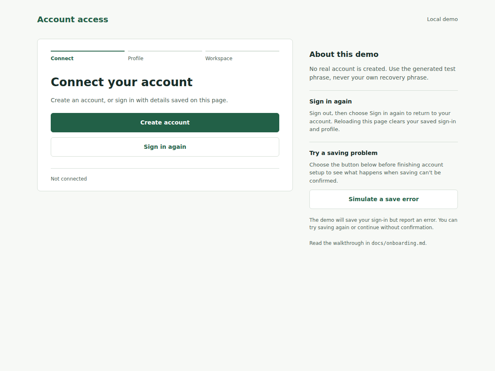
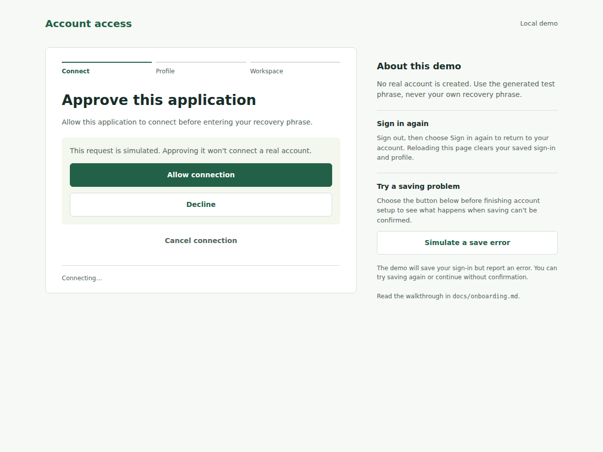
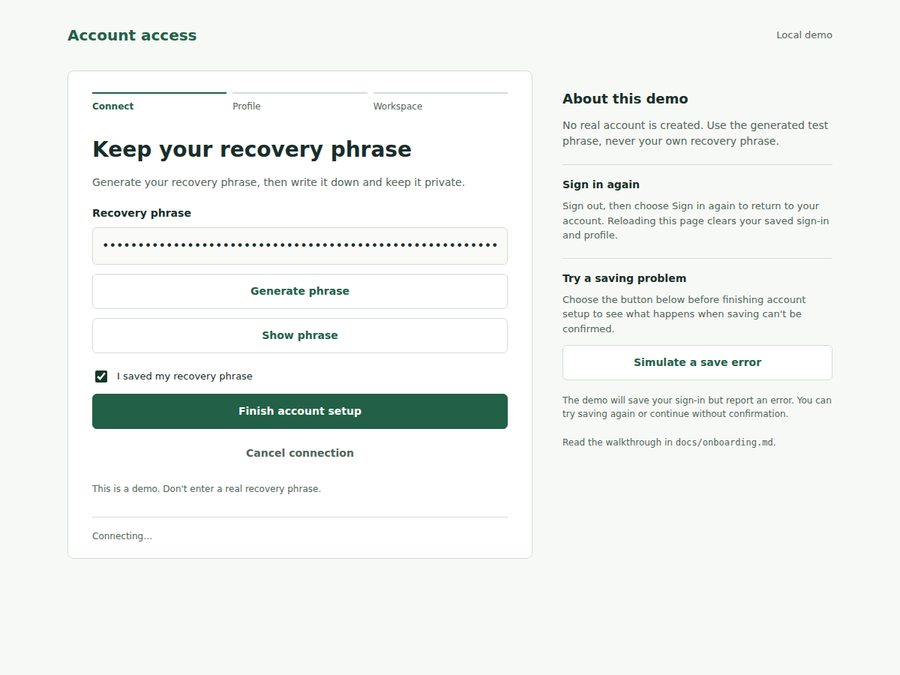
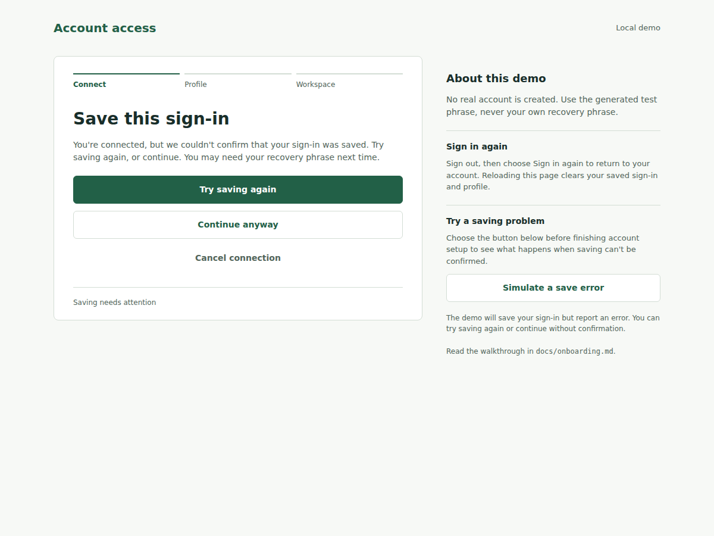
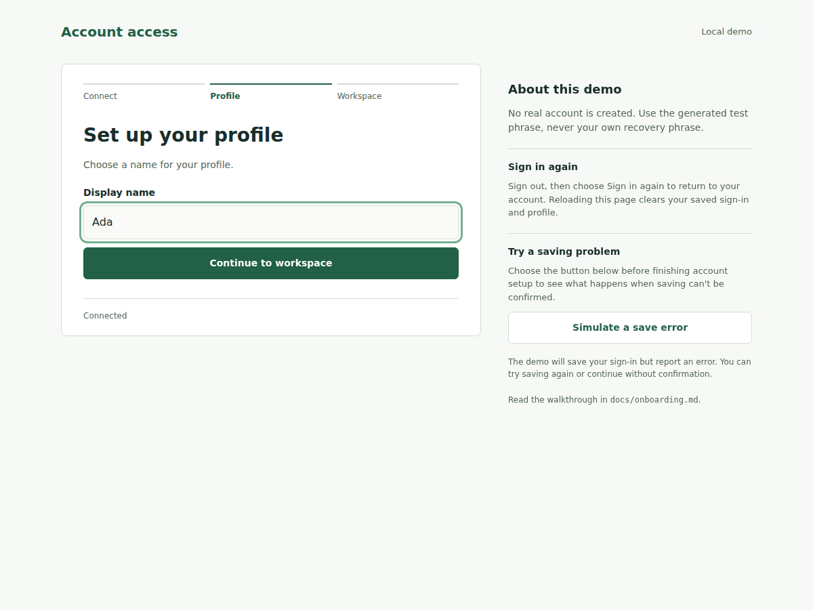
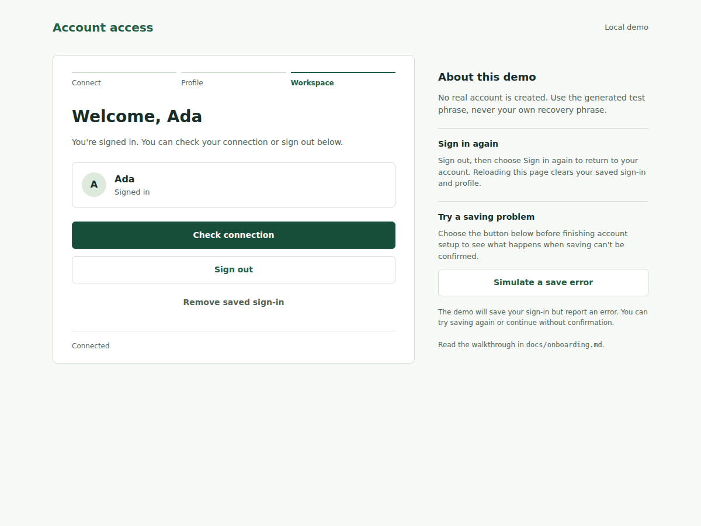

# Build a React login and onboarding screen

Run the example from the package directory:

```sh
pnpm run example:react
```

Open [the local example](http://127.0.0.1:4174/). It uses shared synthetic Sia fixtures, not a live account. Never enter a real recovery phrase. Saved access and the profile stay in memory until you reload the page.

The example has [its own Vite config](../examples/react-onboarding/vite.config.ts). Run it from the package directory with the command above. The library fixtures use a separate Vite server.

`pnpm run example:react:build` compiles the browser bundle. Use the development server to run the demo; `vite preview` does not start its mock backend.

The complete UI is in [account-app.tsx](../examples/react-onboarding/account-app.tsx), with its phrase form in [recovery-form.tsx](../examples/react-onboarding/recovery-form.tsx). The demo bootstrap and approval controls are separate in [main.tsx](../examples/react-onboarding/main.tsx).

## 1. Offer account choices



**Create account** starts authorization. **Sign in again** calls `reconnect()`. On a fresh page there is no saved key, so signing in shows a message and leaves the account choices available.

A create-account button only needs the controller's current availability and an event handler:

```tsx
import { AccessIntent, type SiaAccessInteractions } from "@lumeweb/sia-app-access";
import { useSiaAccessInteractions } from "@lumeweb/sia-app-access/react";

export function CreateAccountButton<Session>({ access }: { readonly access: SiaAccessInteractions<Session> }) {
  const { snapshot, commands } = useSiaAccessInteractions(access);
  return (
    <button disabled={!snapshot.presentation.availability.authorize} onClick={() => void commands.authorize(AccessIntent.Create)}>
      Create account
    </button>
  );
}
```

Keep a result handler when your UI needs to report a failed or unavailable call. The complete example also renders the controller's failed and working states.

## 2. Ask for approval



In the demo, click **Allow connection** or **Decline**. A real application opens the URL supplied by the approval task instead:

```tsx
import { useSiaApproval } from "@lumeweb/sia-app-access/react";

export function ApprovalLink<Session>({ access }: { readonly access: SiaAccessInteractions<Session> }) {
  const task = useSiaApproval(access);
  if (!task) return null;
  return (
    <section>
      {task.url ? (
        <a href={task.url} target="_blank" rel="noreferrer">
          Open approval page
        </a>
      ) : (
        <p>Requesting approval…</p>
      )}
      <button disabled={!task.canCancel} onClick={() => task.cancel()}>
        Cancel connection
      </button>
    </section>
  );
}
```

Denial produces a failed result. **Start again** returns to account choices; **Cancel connection** returns to account choices without claiming that remote work was undone.

## 3. Keep a recovery phrase



Click **Generate phrase**, then **Show phrase** to read the synthetic phrase. Hide it again before sharing a screen. The checkbox is application policy: the example requires the user to confirm their backup before submission.

The task supplies actions; the form owns input and errors. This is how the screen uses the complete form:

```tsx
import { useSiaRecoveryPhrase } from "@lumeweb/sia-app-access/react";
import { RecoveryForm } from "../examples/react-onboarding/recovery-form.tsx";

export function PhraseStep<Session>({ access }: { readonly access: SiaAccessInteractions<Session> }) {
  const task = useSiaRecoveryPhrase(access);
  return task ? <RecoveryForm access={access} task={task} /> : null;
}
```

`RecoveryForm` checks whether input or the controller changed while an action was pending before applying its result. Try entering an invalid phrase: the form shows an error without erasing the input. Generating a replacement clears the backup checkbox, so the user confirms the current phrase. Submission locks the phrase input and backup checkbox until the check finishes; an invalid result unlocks them for correction.

## 4. Handle a failed save



Before submitting a phrase, click **Simulate a save error** in the side panel. The demo saves the synthetic key but reports a lost acknowledgement. The UI offers **Try saving again** and **Continue anyway**.

Both choices keep the registered session; neither registers again. The continuation shows a warning because the result does not confirm saving. A later sign-in may still work, since the write may have succeeded. See the [save recovery component](react.md#recover-saving-without-registering-again).

## 5. Add your application's onboarding



Access is ready before the profile form appears. The access library does not store the display name or decide whether this screen is needed. A profile step is ordinary React state:

```tsx
import { useState } from "react";

export function ProfileStep({ onComplete }: { readonly onComplete: (name: string) => void }) {
  const [name, setName] = useState("");
  return (
    <form
      onSubmit={(event) => {
        event.preventDefault();
        if (name.trim()) onComplete(name.trim());
      }}>
      <label>
        Display name
        <input value={name} onChange={(event) => setName(event.currentTarget.value)} />
      </label>
      <button disabled={!name.trim()}>Continue to workspace</button>
    </form>
  );
}
```

Type a name and continue. The application remembers it while this page stays open. Starting **Create account** or **Connect existing account** clears the previous name and requires profile setup again. **Sign out** followed by **Sign in again** keeps the name for the saved-key reconnect.

## 6. Sign out and return



**Check connection** demonstrates a `withSession` callback; it does not upload or read a file. **Sign out** ends the session but keeps the saved key. Click **Sign in again** to reconnect and return to the workspace. **Remove saved sign-in** removes that key and clears the example's profile.

The demo does not implement importing an existing account's recovery phrase. Its shared synthetic adapter supports creating access and reconnecting with saved keys. The copied UI also offers **Connect existing account** when used without the demo restriction. That path uses the released SDK adapter to match the supplied phrase; it does not offer generation or ask for a new backup confirmation.

## Use a real SDK controller

Copy the UI components into your application and provide a controller using `createSiaAdapter()`. Replace the example addresses and configure the SDK's WASM assets. Remove demo-only text from the copied form; do not include the mock server or approval buttons.

```tsx
import { createRoot } from "react-dom/client";
import { createSiaAccess } from "@lumeweb/sia-app-access";
import { createSiaAdapter } from "@lumeweb/sia-app-access/sia";
import { AccountApp } from "../examples/react-onboarding/account-app.tsx";

export function mountAccountApplication(element: HTMLElement) {
  const access = createSiaAccess({
    application: {
      appId: "a".repeat(64),
      name: "My application",
      description: "Account access",
      serviceUrl: "https://app.example",
    },
    indexerUrl: "https://indexer.example/",
    adapter: createSiaAdapter(),
  });
  const root = createRoot(element);
  root.render(<AccountApp access={access} />);
  return () => {
    root.unmount();
    access.dispose();
  };
}
```

Call this bootstrap once when the application starts. Its cleanup ends the application's controller lifetime, so do not use it merely to hide a dialog or change a route. Choose a [credential store](credentials.md) before relying on sign-in after a reload. The [adapter limits](adapters.md#current-integration-limits) still apply: this walkthrough verifies synthetic UI behavior, not live authorization.
